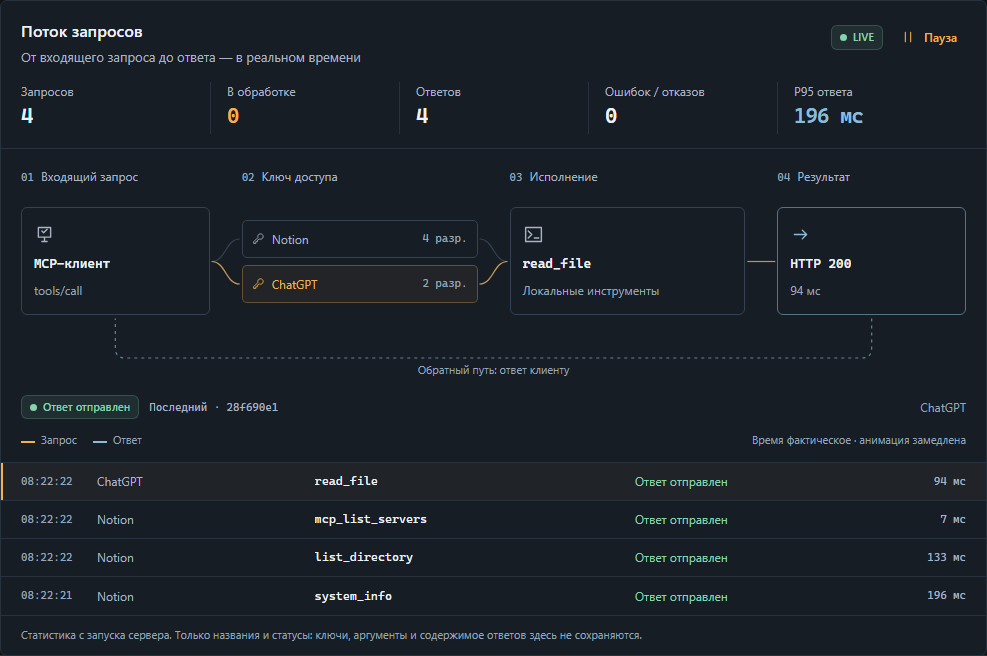

<p align="center">
  
</p>

<h1 align="center">TMCP</h1>
<p align="center"><strong>Ваш компьютер. Любой MCP-клиент.</strong></p>
<p align="center">Личный MCP-туннель с Windows-приложением и терминальной панелью для Linux, macOS и серверов.</p>

<p align="center">
  <a href="https://github.com/HVHBIGNAME/tmcp/actions/workflows/ci.yml"></a>
  <a href="https://github.com/HVHBIGNAME/tmcp/releases"></a>
  
  
</p>

<p align="center">
  <a href="#установка-в-одну-команду">Установить</a> ·
  <a href="#терминальная-панель">CLI</a> ·
  <a href="#подключение-к-notion-и-другим-клиентам">Подключить клиент</a> ·
  <a href="#постоянный-адрес">Свой домен</a> ·
  <a href="docs/troubleshooting.md">Решение проблем</a>
</p>

## Статус проекта

Основная разработка завершена. Ближайшие обновления планируются только для исправления серьёзных поломок и критических ошибок. Новый функционал в ближайшее время, скорее всего, не появится.


## Что внутри

|                            |                                                                                                                  |
| -------------------------- | ---------------------------------------------------------------------------------------------------------------- |
| **Внешняя ссылка**         | Cloudflare Tunnel без проброса портов. Ссылка появляется и обновляется автоматически.                            |
| **Приложение для Windows** | Тёмная и светлая темы, собственные иконки, диалоги и понятные ошибки. Закрытие окна оставляет сервер в трее.     |
| **Команда `tmcp`**         | Меню с выбором цифрами: сервер, ссылка, ключи, Telegram, подтверждения, журнал и автозапуск.                     |
| **Ключи доступа**          | Отдельные токены для интеграций, выбор разрешений, приостановка, замена и отзыв.                                 |
| **Живой поток запросов**   | Маршрут клиент → ключ → инструмент → ответ, ожидание подтверждения, фактическая длительность и история.          |
| **Файлы и команды**        | Чтение, поиск, правка файлов; фоновые команды с ID задачи, ограничением вывода и опросом результата.             |
| **MCP-шлюз**               | Обнаружение локальных конфигураций, stdio, Streamable HTTP и legacy SSE; подключение инструментов по запросу.    |
| **Telegram**               | Проверка бота, состояние сервера, подтверждение команд и удалённое управление из разрешённых чатов.              |
| **Восстановление**         | Туннель переподключается отдельно от команд. Фоновый наблюдатель запускает сервер после завершения его процесса. |

## Установка в одну команду

### Windows

**[Скачайте TMCP.exe](https://github.com/HVHBIGNAME/tmcp/releases/latest/download/TMCP.exe) и запустите.** В релизе один автономный EXE для Windows x64: Node.js, .NET, Fixed WebView2 и cloudflared уже внутри. При первом запуске рабочая копия EXE и компоненты сохраняются в `%LOCALAPPDATA%\TMCP`; устанавливать зависимости вручную не нужно.

Для установки с командой `tmcp` и ярлыком в меню «Пуск» откройте **PowerShell**:

```powershell
irm https://raw.githubusercontent.com/HVHBIGNAME/tmcp/main/install.ps1 | iex
```

Установщик загружает тот же EXE и проверяет SHA-256 из метаданных GitHub-релиза. На обычной Windows выбирается **GUI**, на Windows Server — **CLI**.

Чтобы явно выбрать CLI:

```powershell
& ([scriptblock]::Create((irm https://raw.githubusercontent.com/HVHBIGNAME/tmcp/main/install.ps1))) -Mode cli
```

### Linux / macOS

```sh
curl -fsSL https://raw.githubusercontent.com/HVHBIGNAME/tmcp/main/install.sh | sh
```

Терминальная версия собирается из исходников выбранного тега GitHub. Если совместимого Node.js нет, установщик добавляет собственный Node.js 24 LTS. `cloudflared` также устанавливается автоматически; загружаемые Node.js и cloudflared проверяются по SHA-256.

**По умолчанию:**

- Windows: `%LOCALAPPDATA%\TMCP`.
- Linux/macOS: `~/.local/share/tmcp`, команда в `~/.local/bin/tmcp`.
- Рабочая папка для MCP: домашняя папка пользователя. Для другой папки укажите `-Root` в PowerShell или `TMCP_ROOT` на Unix.
- Сервер запускается после установки. Автозапуск **не включается без вашего выбора**.
- Поддерживаемые пакеты: Windows x64; Linux и macOS x64/arm64. Linux-пакет Node.js требует glibc, либо уже установленный совместимый Node.js.

Откройте новый терминал и выполните:

```sh
tmcp
```

Для нестандартного каталога, фиксированной версии и установки без запуска см. [параметры установщика](docs/installation.md).

## Терминальная панель

```text
╭─ TMCP ──────────────────────────────────────╮
  1  Запустить          2  Состояние и ссылка
  3  Ключи доступа      4  Настроить туннель
  5  Telegram           6  Запросы на подтверждение
  7  Автозапуск         8  Журнал
  9  Остановить         0  Закрыть панель
╰────────────────────────────────────────────╯
Выбор:
```

Закрытие терминальной панели оставляет сервер работать в фоне. Для автоматизации есть обычные команды:

```sh
tmcp start
tmcp status --json
tmcp url
tmcp token create --name Notion --permissions files:read,files:write,shell,gateway
tmcp token list
tmcp token disable TOKEN_ID
tmcp token enable TOKEN_ID
tmcp token rotate TOKEN_ID
tmcp token delete TOKEN_ID --yes
tmcp logs
tmcp stop
```

Новый токен выводится **один раз**. В хранилище токенов сохраняется только его SHA-256. Пароли бота и Cloudflare в интерактивном меню вводятся без отображения.

## Поток запросов

На главной странице видны ключ клиента, вызванный инструмент, ожидание подтверждения и отправка ответа. События поступают через защищённый локальный IPC. Нажмите строку истории для просмотра запроса; кнопка **Следить** возвращает к новым событиям.



Счётчики относятся к текущему запуску, P95 — к последним 128 ответам. Анимация замедлена для наглядности, длительность измеряется сервером. В поток не включаются ключи, аргументы и содержимое файлов или ответов. Учитывается системная настройка уменьшения анимации.

## Подключение к Notion и другим клиентам

1. Получите **внешнюю HTTPS-ссылку** в приложении или через `tmcp url`.
2. Создайте токен в разделе **Доступ** или командой `tmcp token create`.
3. Добавьте **Custom MCP server / Streamable HTTP** в клиенте:

   ```text
   URL:           https://your-tunnel.trycloudflare.com/mcp
   Authorization: Bearer <ваш токен>
   ```

В Notion настройка находится в инструментах Custom Agent: **Tools & Access → Add connection → Custom MCP server**. Клиенты с поддержкой OAuth проходят подключение сами: сервер открывает страницу подтверждения, вы вводите ключ из раздела «Доступ» и нажимаете «Разрешить доступ». Приложение получает OAuth-токен с теми же правами, что и этот ключ: отключите или замените ключ — доступ приложения тоже прекратится.

MCP принимает только ключи, выпущенные приложением, и OAuth-токены, привязанные к таким ключам. Новый ключ по умолчанию разрешает чтение файлов; остальные права выбираются явно. [Модель доступа и обновление](docs/access-model.md).

Адрес `http://127.0.0.1:18787/mcp` работает **только на этом компьютере**. Панель показывает его отдельно и не выдаёт за внешнюю ссылку.


### Разрешения

| Разрешение    | Возможности                                                                      |
| ------------- | -------------------------------------------------------------------------------- |
| `files:read`  | Чтение, поиск, список файлов и папок                                             |
| `files:write` | Создание, правка, перемещение и удаление                                         |
| `shell`       | Запуск, чтение, остановка команд и ввод в stdin                                  |
| `screen`      | Скриншоты и список дисплеев                                                      |
| `gateway`     | Инструменты подключённых MCP-серверов                                            |
| `log`         | `read_audit`: недавние события этого клиента; панель владельца видит все события |


## Постоянный адрес

**Quick Tunnel — временный адрес.** Он меняется при пересоздании туннеля или перезапуске сервера. Автовосстановление не может закрепить имя `trycloudflare.com`: после его смены клиенту нужна новая ссылка.

Для постоянного подключения:

1. Создайте remotely-managed tunnel в **Cloudflare Zero Trust**.
2. Добавьте Public Hostname, например `mcp.example.com`, с сервисом `http://127.0.0.1:18787`.
3. В **Настройки → Внешнее подключение** выберите **Свой домен**, введите hostname и connector token.
4. Нажмите **Сохранить и применить**. В CLI это пункт **4**.

Теперь MCP-адрес — `https://mcp.example.com/mcp`. Домен остаётся прежним после перезапуска. Доступность всё ещё зависит от ПК, сети и Cloudflare.

## Автозапуск

В приложении: **Настройки → Автозагрузка и трей**. При включении регистрируется запуск постоянной копии `%LOCALAPPDATA%\TMCP\TMCP.exe` при входе пользователя. Исходную копию из «Загрузок» можно удалить.

Параметр **Запускать свёрнутым в трей** сохраняется отдельно. Закрытие окна оставляет сервер работать; полный выход — **правая кнопка по значку → Остановить сервер и выйти из TMCP…**. В трее также доступны состояние, ключи, подтверждения, ссылка, перезапуск и журнал. Повторный запуск EXE возвращает уже открытое приложение.

В терминале:

```sh
tmcp autostart on
tmcp autostart status
tmcp autostart off
```

| Платформа | Механизм                                                          |
| --------- | ----------------------------------------------------------------- |
| Windows   | Автозапуск текущего пользователя, свёрнутый запуск — по настройке |
| Linux     | Пользовательский unit `tmcp.service` через `systemd --user`       |
| macOS     | LaunchAgent `com.tmcp.agent`                                      |

Это запуск **при входе пользователя**. На Linux-сервере для запуска до входа и работы после выхода можно отдельно включить lingering:

```sh
sudo loginctl enable-linger "$USER"
systemctl --user start tmcp.service
```

В контейнере без пользовательского systemd запускайте `node dist/src/daemon.js` через менеджер процессов контейнера.

## Автообновление Windows-приложения

Начиная с 2.1.0 приложение проверяет стабильные релизы этого репозитория через 30 секунд после запуска и затем каждые 6 часов. Пока приложение открыто или работает в трее, оно само загружает новый `TMCP.exe`, проверяет размер и SHA-256, ждёт завершения команд, MCP-вызовов и редактирования форм, устанавливает обновление и перезапускается. Дополнительное подтверждение не требуется.

Настройка **Обновлять автоматически** включена по умолчанию. В **Настройки → Обновления из GitHub** видны версия и ход загрузки; кнопка **Проверить и обновить** запускает проверку вручную. Ключи, `.env` и настройки остаются в прежнем каталоге. Если новый процесс не сообщает о готовности, установщик восстанавливает предыдущий EXE и запускает его снова. Версия, вызвавшая откат, автоматически повторно не устанавливается до следующего релиза; ручная проверка позволяет повторить попытку.

Для первого перехода с 2.0.x нужно один раз скачать новый EXE: старые версии ещё не содержат механизма автообновления. Затем обновления происходят автоматически. Режим CLI без запущенного Windows GUI обновляется установщиком; автоматический фоновый цикл работает в Windows-приложении, в том числе в трее.

## Telegram

Создайте бота через **@BotFather**, напишите ему `/start` и сохраните токен и числовые ID разрешённых чатов. Панель проверяет ответ Telegram; изменения применяются без перезапуска сервера.

Команды: `/status`, `/pending`, `/allow <id> [all]`, `/deny <id>`, `/servers`, `/token <name>`, `/on <id>`, `/off <id>`, `/tunnel`, `/help`.

Кнопки подтверждения привязаны к ID ожидающего запроса. Повторное или просроченное подтверждение не запускает команду ещё раз.

## Светлая тема


Скриншоты созданы на изолированном демонстрационном сервере. Адрес `workstation.tmcp.example` — пример; настоящих токенов на снимках нет.

## Запуск из исходников

Нужны Node.js **22.16+** и `cloudflared`. Для сборки Windows GUI — .NET SDK **8**.

```sh
git clone https://github.com/HVHBIGNAME/tmcp.git
cd tmcp
npm ci
npm run build
node dist/src/cli.js setup --root /path/to/workspace
node dist/src/cli.js start
```

На Windows GUI:

```powershell
npm run build:ui
.\dist-ui\PcMcp.exe
```

### Проверки

```sh
npm run check
npm run format:check
npm test
npx playwright install chromium
npm run test:ui
npm run test:a11y
```

Тесты создают временные ключи и настройки; Telegram проверяется через локальный тестовый API. CI запускает core-тесты на Windows, Linux и macOS, browser-тесты в Chromium и сборку WinForms.

### Контракты инструментов

`system_info` возвращает права текущего ключа, доступные инструменты, поддерживаемые shell и лимиты. Каталог скрывает недоступные возможности. Native-инструменты публикуют схемы результатов; неизвестные параметры отклоняются, чтобы опечатка не меняла смысл операции незаметно.

- `read_file`: продолжайте с **обоими** `next_line` и `next_column`. Длинная строка может занимать несколько страниц. Для правок используйте `sha256`, учитывайте `bom` и `line_ending`.
- `list_directory`, `find_files`, `search_text`: продолжайте с `next_offset`, сохраняя остальные параметры. При `scan_limit_reached` сузьте путь. Дерево файлов между страницами должно оставаться неизменным.
- `run_command`: сохраните `job_id`; передавайте оба выходных курсора в `read_command`. Дочитывайте вывод после завершения, пока `stdout_more` или `stderr_more` истинны. Для фоновой работы используйте `wait_ms: 0` и команду, остающуюся на переднем плане своего задания: обычные потомки завершаются вместе с ним.
- Gateway: получите точные ID и схемы через `mcp_list_servers` / `mcp_list_tools`. Если получен `call_id`, опрашивайте `mcp_read_call`, а не повторяйте исходный вызов. После обновления заново получите namespaced-каталог: имена теперь ограничены 64 символами.
- Отмена снимает ожидающее подтверждение и передаётся выполняемой операции. Уже совершённые изменения файлов или действия backend не откатываются автоматически. Ошибки native-инструментов имеют `isError`, читаемый текст и metadata `_meta["tmcp/error"]`; success-схема не подменяется форматом ошибки.

[Матрица аудита, точные ограничения и команды проверок](docs/tool-audit.md).

## Как это устроено

```text
MCP-клиент ── HTTPS ── Cloudflare Tunnel ── 127.0.0.1:18787
                                             │
                                      MCP / OAuth / задачи
                                             │
                                      Файлы · Shell · MCP

Desktop / tmcp CLI ── защищённый IPC ── локальное управление
                            │
                   настройки · ключи · подтверждения
```

Файловые инструменты ограничены `MCP_ROOTS`. Shell-команды исполняются с правами пользователя ОС и не являются песочницей. Управление использует Windows named pipe с ACL владельца или Unix socket с правами `0600` в закрытом каталоге. GUI и CLI должны запускаться от того же пользователя ОС, что и сервер.

Настройки находятся в `.env` и `.mcp-tunnel/settings.json`. Эти файлы, журналы, пользовательские токены и данные браузера исключены из Git и release-архивов.

**Нужна помощь?** [Диагностика и частые вопросы](docs/troubleshooting.md) · [Создать issue](https://github.com/HVHBIGNAME/tmcp/issues/new)
